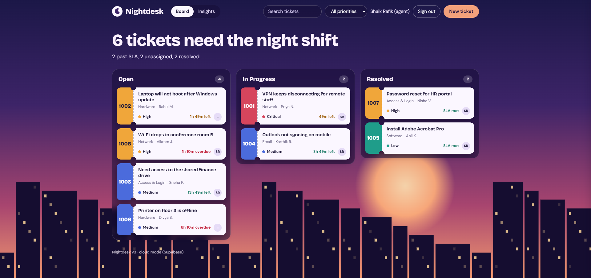
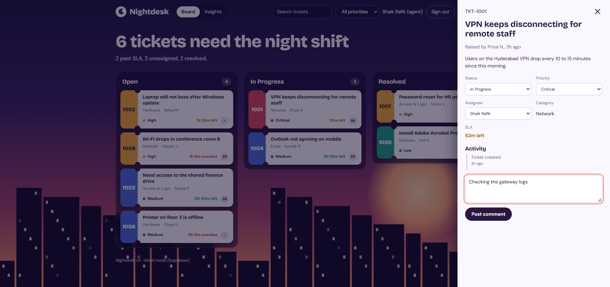
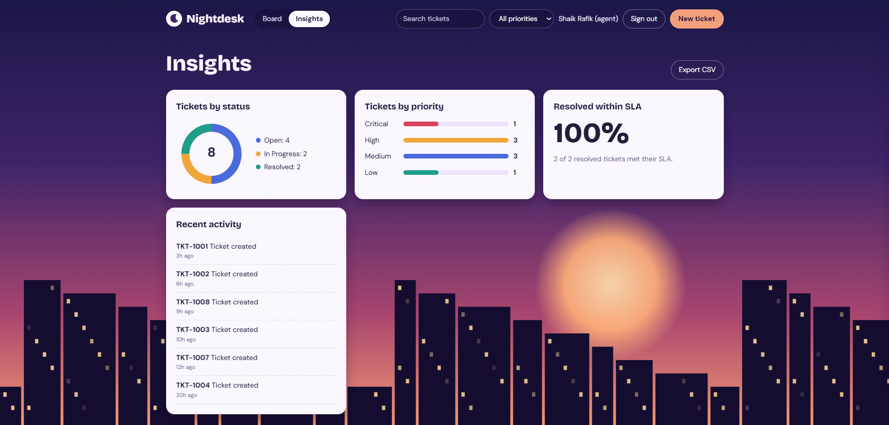
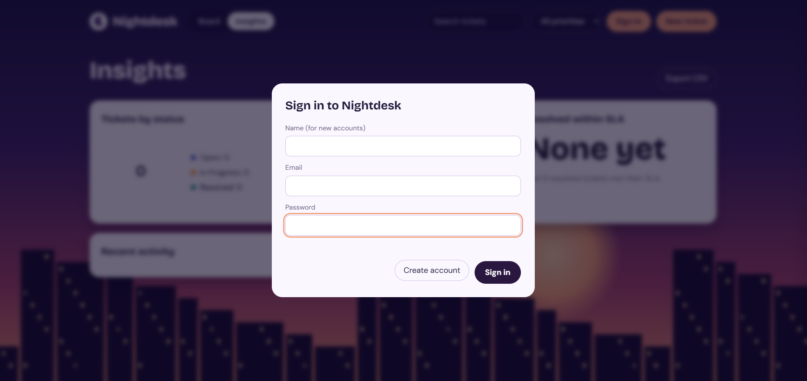

# Nightdesk – IT Helpdesk Ticketing System

A helpdesk app where employees raise IT tickets and support agents work them from open to resolved. Tickets appear as ticket stubs on a drag-and-drop board, every ticket has an SLA timer based on its priority, and access is controlled by role.

**Live demo:** [https://YOUR-VERCEL-LINK.vercel.app](https://YOUR-VERCEL-LINK.vercel.app)



## Features

- **Ticket board:** Open, In Progress and Resolved columns. Agents drag a ticket to another column to change its status.
- **SLA timers:** Critical 4 hours, High 8 hours, Medium 24 hours, Low 72 hours. Each ticket shows time left, overdue, SLA met or SLA missed.
- **Ticket details panel:** change status, priority and assignee, read the activity timeline and post comments.
- **Two roles:**
  - **Agents** see every ticket and can update them.
  - **Requesters** see only their own tickets and can raise tickets and comment.
- **Real accounts:** sign up, sign in and sign out with Supabase Auth.
- **Shared database:** tickets are stored in PostgreSQL, so they persist and are shared between users.
- **Live updates:** the board refreshes when someone else changes a ticket.
- **Insights tab:** tickets by status and priority, the share of resolved tickets that met their SLA, and recent activity.
- **Search, priority filter and CSV export.**
- **Demo mode:** if no Supabase keys are set, the app runs on browser storage with sample tickets, so it can be tried without any setup.

## Screenshots

| Ticket details | Insights |
|---|---|
|  |  |



## Tech stack

- HTML5, CSS3 and JavaScript (ES6), with no framework and no build step
- Supabase: Auth, PostgreSQL, Row Level Security and Realtime
- Native browser drag and drop, and SVG for the charts
- Git and GitHub
- Vercel (deployment)

## How it works

1. A user signs up. A database trigger creates a profile row with the role `requester`.
2. A requester creates a ticket. The ticket is saved in the `tickets` table with their user ID.
3. An agent opens the board and sees all tickets. Dragging a ticket, or changing its fields, updates the row and adds an entry to the ticket's activity log.
4. The SLA deadline is the ticket's created time plus the hours allowed for its priority. The app compares that with the current time to show time left, overdue, met or missed.
5. Supabase Realtime tells other open boards to refresh.

## Database

| Table | Purpose |
|---|---|
| `profiles` | One row per user: name and role (`agent` or `requester`) |
| `tickets` | Title, description, category, priority, status, assignee, requester, activity log, timestamps |
| `comments` | Comments linked to a ticket |

**Security is enforced in the database with Row Level Security,** not only in the page code:
- Requesters can read and create only their own tickets, and a new ticket must start as Open and Unassigned.
- Only agents can update tickets.
- Comments can be added only to tickets the user owns, or by agents.
- Roles cannot be changed from the app.

## Project structure

```
nightdesk-helpdesk/
├── index.html                 # the whole app (HTML, CSS and JavaScript)
├── supabase_setup.sql         # tables, trigger, security rules, realtime
├── supabase_sample_data.sql   # makes the first account an agent and adds sample tickets
├── README.md
└── screenshots/
```

## Run it yourself

### Option A: demo mode (no setup)

```bash
git clone https://github.com/RafikShaik07/nightdesk-helpdesk.git
cd nightdesk-helpdesk
```

Open `index.html` in Chrome or Edge. With no Supabase keys set, it runs in demo mode with sample tickets stored in your browser.

### Option B: with your own Supabase project

1. Create a free project at [supabase.com](https://supabase.com).
2. In **SQL Editor**, run `supabase_setup.sql`.
3. In **Authentication > Sign In / Providers > Email**, turn off **Confirm email** (easier for testing).
4. In **Project Settings > API**, copy your **Project URL** and **anon (public) key**, and paste them near the top of the script in `index.html`:
   ```js
   const SUPABASE_URL='https://YOUR-PROJECT.supabase.co', SUPABASE_KEY='YOUR-ANON-KEY';
   ```
5. Open the app, click **Create account**, then run `supabase_sample_data.sql` in the SQL Editor. This makes your account an agent and adds sample tickets.

> The anon key is designed to be public, and the Row Level Security rules protect the data. **Never** put the `service_role` or secret key in this file.

## Deploy

1. Push the repository to GitHub.
2. Import it in [vercel.com](https://vercel.com) and click **Deploy**. No build settings are needed.

## What I learned

- Designing a relational schema and writing Row Level Security policies
- Role-based access control, enforced in the database
- Authentication flows with Supabase
- SLA logic and date handling in JavaScript
- Escaping user input to prevent HTML injection
- Debugging and deploying a full-stack app

## Future improvements

- Email notifications when a ticket is assigned or resolved
- File attachments on tickets
- A separate table for the activity log
- An admin screen to promote users to agents
- Automatic escalation when a ticket is about to breach its SLA

## Author

**Shaik Rafik**

- GitHub: [RafikShaik07](https://github.com/RafikShaik07)
- LinkedIn: [shaik-rafik](https://www.linkedin.com/in/shaik-rafik-79a7253a9/)
- Portfolio: [shaikrafikportfolio.vercel.app](https://shaikrafikportfolio.vercel.app/)
